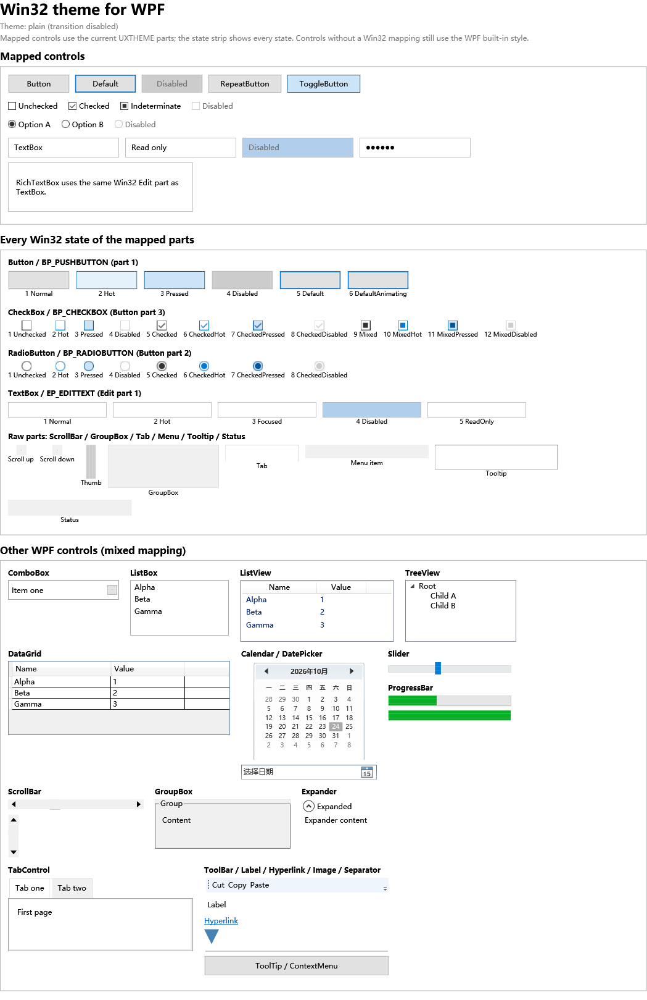
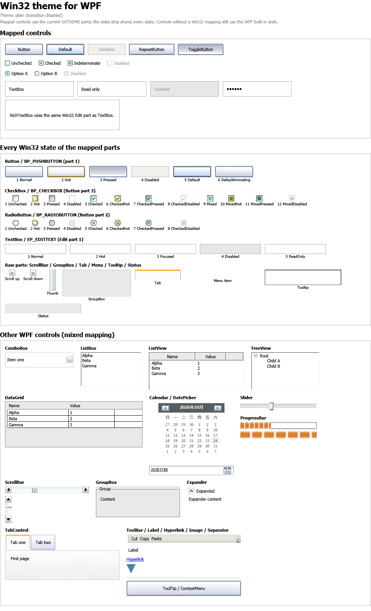

# PresentationFramework.Theme

在 WPF 中直接使用 **Win32 视觉样式（UXTHEME）** 的控件主题库。

引入一个 `ResourceDictionary` 后，已映射的 WPF 控件会使用当前 Windows 主题的真实部件绘制，
而不是 WPF 自带皮肤的近似效果。库同时提供**无过渡**和**带过渡**两个版本。

| 无过渡（theme.xaml） | 带过渡（theme.withtransition.xaml） |
| --- | --- |
|  |  |

## XP 上 plain 与 transition 外观不同的原因

连续两次单独运行 plain，`images-created-after-show` 都是 38；transition 稳定是 54，
native 是 Plex 蓝色。说明不是“第一次进程”问题，而是 plain/transition 的启动路径不同：

- 原来 plain 主题是在 `App.xaml` 的 `Application.Resources` 里**静态合并**的；
- transition 是在 `App.OnStartup` 里**清空后重新合并**的；
- XP 上这两种加载顺序会让 WPF/UxTheme 的首次使用时机不同，plain 会拿到旧主题图。

现在 `App.xaml` 只保留空 ResourceDictionary，plain/transition 都在 `App.OnStartup` 里走
同一段代码、同一个时机加载。另外仍然保留：

- 首次 `Loaded` 延迟、HWND 非 0 才取图；
- 窗口显示后 `ThemeImageDiagnostics.RefreshAll()` 清缓存并重绘；
- `Run-All.bat` 先跑 NativeComparison 预热。
### XP Plex 验证结果

在 XP + `Longhorn Slate Plex` 下确认：

```text
plain:      images-created-after-show=54
transition: images-created-after-show=54
native:     真实 Plex 控件
```



plain/transition 现在只有 150 ms 过渡动画的差别；静态外观一致。同时给 Window 应用了
`SystemFonts.MessageFontFamily/MessageFontSize`，XP 上使用 Tahoma 8.25pt 而不是 WPF 默认
Segoe UI，文字尺寸更接近原生控件。
### ComboBox 下拉按钮：直接使用 Win32 资源

`Combobox` 的 `CP_DROPDOWNBUTTON(1)` 是一个**完整部件**：按钮面 + 箭头 glyph，不是两层。
之前用系统色按钮面 + 矢量箭头拆分是错误方向；现在改回：

```xml
<pt:HackImage x:Name="ArrowButton"
              th:ThemeImage.Class="Combobox"
              th:ThemeImage.Part="1"
              th:ThemeImage.State="1"
              Width="18" VerticalAlignment="Stretch" />
```

- `State=1/2/3/4` 对应 normal/hot/pressed/disabled；
- RTL 时切到 `CP_DROPDOWNBUTTONRIGHT(6)` 并靠左；
- 不再使用 `SystemColors` 伪造按钮面。

**注意**：原生截图里按钮是蓝色，可能是鼠标停在 ComboBox 上触发了 hot 状态；WPF 截图光标不在控件上，
所以显示 normal 的灰色。比较 normal 状态时要把鼠标移开。

真正需要“前后景/边缘拆分”的是 Header、Tab 的左右边缘、Menu 的勾选列/子菜单箭头等；
ComboBox 下拉按钮本身不是这种结构。
## 诊断日志与 HackImage/Image 选择

`selftest.log` 现在会输出所有运行参数：

- OS/位数/CLR/culture；
- working set、managed bytes、进程句柄、private bytes；
- DPI、window DIP、window pixel；
- 主题文件/配色/尺寸、AppThemed/ThemeActive；
- 创建/缓存图片数；
- 每个缓存键：`theme-file|color|size|class|part|state|hwnd|dpi`。

例如：

```text
image-cache=...\Aero.msstyles|NormalColor|NormalSize|TrackBar|5|1|3214018|1.25
```

### ThemePart：直接按最终尺寸绘制

WPF 的 `OnRender` 没有 HDC，所以“UxTheme 直接画”只能落到一个位图表面（或 HwndHost）。
本库新增了 `ThemePart` 控件，专门做前者：

```xml
<pt:ThemePart ClassName="Progress" PartId="5" StateId="1" />
```

`ThemePart`：

- 在 `Loaded`/`SizeChanged` 时按 `ActualWidth/Height × DPI` 调
  `GetSized(...)`；
- `DrawThemeBackground` 在**最终像素矩形**上绘制，不九宫格；
- 1:1 绘制 `BitmapSource`；
- `Unloaded` 释放数据，缓存仍是弱引用；
- 适合 ComboBox 下拉按钮、ProgressBar、Slider 轨道/Thumb、ScrollBar 箭头/Thumb/轨道等
  “尺寸/状态完全由 UxTheme 决定”的 part。

Button/CheckBox/Radio 等仍有大量 WPF 文本/布局因素，继续用 `HackImage`/`Image`，
不会为了一个按钮面引入额外窗口。

HwndHost 方案（真正子 HWND 绘制）没有采用：airspace、Popup/Adorner 遮挡、
每控件一个 HWND 与低资源目标冲突。
### Theme Explorer 的演示方式与 WPF 的对应

Theme Explorer 的 `ThemePreviewControl` 不是把 part 先渲染成图片再九宫格，而是每次 `OnPaint`：

1. `graphics.Clear(BackColor)`；
2. 如果 `IsBackgroundPartiallyTransparent`，调用 `TryDrawParentBackground`；
3. 直接 `TryDrawBackground(style, part, state, ClientRectangle)`；
4. 需要文字时调用 `TryDrawText`。

预览控件本身有 9 种尺寸（16×16、24×16、48×18、32×32、48×32、64×32、48×48、72×48、80×48），
所以同一个 part 在**最终尺寸**上由 UxTheme 自己完成拉伸/边距/布局。

WPF 这边现在也走“最终尺寸”：

- `ThemeImageHost` 取元素 `ActualWidth/ActualHeight × DPI`，调
  `ThemeImageProvider.GetSized(...)`；
- `GetSized` 用 `DrawThemeBackground` 在**目标像素矩形**上直接绘制；
- `HackImage` 在 `HackThickness=0` 时只画整张图，不再制造 9 个相同切片；
- 固定 glyph/箭头继续用 `Image`，避免布局拉伸。

这比之前“64×40 预渲染 + WPF 九宫格”更接近 Theme Explorer 的预览结果。
### 九宫格由 UxTheme 数据决定

是否做九宫格不应由控件名硬编码，而应由 `TMT_SIZINGMARGINS(3601)` 决定：

- `GetThemeMargins` 返回的 left/top/right/bottom > 0 → 九宫格；
- 全部为 0 → 普通位图，直接铺满。

`ThemeImageProvider` 已经在 `TryGetMargins` 中读取 `TMT_SIZINGMARGINS`，并按
`TMT_CONTENTMARGINS`、`TMT_BORDERSIZE` 和保守默认值回退。宿主把结果写进
`HackImage.HackThickness`。

现在 `HackImage` 自己也检查 `HackThickness`：

```csharp
if (l <= 0 && t <= 0 && r <= 0 && b <= 0)
{
    var whole = _slices[Center] ?? _bitmapSource;
    dc.DrawImage(whole, new Rect(0, 0, targetW, targetH));
    return;
}
```

所以：

- 有 margins → 九宫格切片；
- 无 margins → 单张位图，行为等同 `Image`。

`Image` 仍然用于固定尺寸、需要自然布局的 glyph/箭头/Thumb；它不是用来“猜测”九宫格的，
九宫格判断完全来自 UxTheme。
### HackImage 不是万能的

- `HackImage`：保留给需要九宫格拉伸的**按钮面、边框、Header/Tab 背景、GroupBox、Progress**；
- `Image`：固定尺寸的 **glyph / 箭头 / Thumb / gripper** 改用 `Image`，避免 `HackImage` 的切片/拉伸把箭头或 glyph 变形：
  - CheckBox / RadioButton 的勾选 glyph；
  - ScrollBar 四方向箭头、Thumb、gripper；
  - Slider Thumb 和 Track；
  - ComboBox 下拉按钮；
  - Menu 子菜单箭头；
  - StatusBar gripper。

两者都走同一个 `ThemeImage` 懒加载/弱缓存宿主，区别只是 `HackImage` 做九宫格、`Image` 按固定图像绘制。
## Slider / ScrollBar 的各种情况

### Slider（TrackBar）

Win32 TrackBar 的部件不是只有一套：

| 情况 | Win32 部件 | 当前实现 |
| --- | --- | --- |
| 水平、无刻度 | `TKP_TRACK(1)` + `TKP_THUMB(3)` | ✅ |
| 水平、刻度在上 | `TKP_TRACK(1)` + `TKP_THUMBTOP(5)` + `TKP_TICS(9)` | ✅ 轨道 + Thumb 5 |
| 水平、刻度在下 | `TKP_TRACK(1)` + `TKP_THUMBBOTTOM(4)` + `TKP_TICS(9)` | ✅ 轨道 + Thumb 4 |
| 水平、上下都有 | 上述组合 | ✅ 轨道 + 通用 Thumb 3 |
| 垂直、无刻度 | `TKP_TRACKVERT(2)` + `TKP_THUMBVERT(6)` | ✅ |
| 垂直、刻度在左/右 | `TKP_THUMBLEFT(7)` / `TKP_THUMBRIGHT(8)` + `TKP_TICSVERT(10)` | ✅ 轨道 + Thumb 7/8 |

- **导轨粗细**：视觉导轨固定 2 px，和原生 TrackBar 的细线接近；之前是 12 px，明显偏粗。
- **交互区域**：Slider 根 Grid 是 24/32/36 px 高的透明命中区；轨道图 `IsHitTestVisible=False`，
  刻度 `TickBar` 也不参与命中；点击轨道、拖动 Thumb 由 `Track` 的透明 RepeatButton/Thumb 处理。
  所以“看到的细线”和“可点击的整行”是分离的。
- **刻度**：当前用 WPF `TickBar`（细灰刻度）按 `Minimum/Maximum/TickFrequency/TickPlacement` 生成，
  因为 Win32 的 `TKP_TICS` 位图不能直接平铺；下一步若要完全像素一致，需要把 TICS 图做成
  `ImageBrush` 平铺，而不是拉伸。
- **待补**：带刻度时 Win32 使用 `THUMBTOP/THUMBBOTTOM/THUMBLEFT/THUMBRIGHT`，当前仍用
  通用 Thumb 部件；这是下一步模板精度工作。


### NativeComparison 的分组截图

```text
NativeComparison.exe --out=logs\native-win32.png
NativeComparison.exe --form=sliders --out=logs\native-sliders.png
NativeComparison.exe --form=scrollbars --out=logs\native-scrollbars.png
```

- `sliders`：水平 None/TopLeft/BottomRight/Both/Disabled，垂直 None/Left/Right/Both/Disabled；
- `scrollbars`：水平/垂直、启用/禁用、最大值；
- `Run-Native.bat` 会一次生成三张图，`Run-All.bat` 也会调用它。
### ListView / ListBox / DataGrid

- `GridViewColumnHeader` 使用 `Header` part 1，TopLeft/Hot/Pressed 状态；
- `ListView` 保留 GridView 的行 presenter（不能替换 `ListViewItem.Template`，否则列布局会变成
  `ToString()`），只换 Header 和背景；
- `ListBox` 边框使用 `Listbox` 边框部件，Item 选中/热状态使用 part 5；
- `DataGrid` 的列头复用 `Header` part 1，网格/背景使用系统色。

`TreeView`、`Calendar`、`DatePicker` 目前只做了背景/边框系统色，内部仍是 WPF 模板。

### ScrollBar

“上下左右箭头”属于 ScrollBar，不是 Slider：

- 四方向箭头：`SBP_ARROWBTN(1)` 的 up/down/left/right 状态组；
- 水平/垂直 Thumb：`SBP_THUMBBTNHORZ(2)` / `SBP_THUMBVERT(3)`；
- 上下/左右轨道：part 4–7；
- 抓手：part 8/9；
- 箭头按钮 17×17，整条轨道和翻页按钮都是可点击区域，Thumb 只占视觉上的那一块。
## 与原生 Win32 对比

`NativeComparison.exe` 是一个纯 Win32/WinForms 对照窗口，使用 `Application.EnableVisualStyles()` +
comctl32 v6 manifest，直接创建原生 Button / CheckBox / ComboBox / TrackBar / ProgressBar /
TabControl / ScrollBar / StatusBar / ToolTip / ContextMenu：

```powershell
.\NativeComparison\bin\Release\NativeComparison.exe --out=native.png
```


### 哪些部分是 UxTheme，哪些不是

- **是**：背景/边框像素通过 `OpenThemeData(hwnd, class)` + `DrawThemeBackground` 绘制；
  尺寸与九宫格来自 `GetThemePartSize` / `GetThemeMargins`。
- **不是**：文字没有用 `DrawThemeText`，仍是 WPF `ContentPresenter`（字体、行高、内边距由
  WPF/模板决定）；ScrollBar 箭头叠加了 WPF `Path`；顶级菜单用系统色高亮；部分部件在缺失时
  使用 fallback margin/近似布局。
- `HackImage` 会把主题部件先渲染成 64×40 或自然尺寸的图片再九宫格拉伸；原生控件是在最终
  尺寸上直接 `DrawThemeBackground`，所以边角、圆角、细线可能有细微差别。
- 因此准确说法是：**用 UxTheme 的真实部件图作为 WPF 模板的背景素材**，不是“整个控件由
  UxTheme 原生绘制”。
## 快速使用

把主题字典合并到应用（或窗口）资源即可，隐式样式会自动生效：

```xml
<Application.Resources>
  <ResourceDictionary>
    <ResourceDictionary.MergedDictionaries>
      <ResourceDictionary Source="pack://application:,,,/PresentationFramework.Theme;component/theme.xaml" />
    </ResourceDictionary.MergedDictionaries>
  </ResourceDictionary>
</Application.Resources>
```

带过渡效果（状态切换时交叉淡入，150 ms）：

```xml
<ResourceDictionary Source="pack://application:,,,/PresentationFramework.Theme;component/theme.withtransition.xaml" />
```

引用程序集：`PresentationFramework.Theme.dll`、`ThemeExplorer.Core.dll`。

> 请在创建窗口/控件之前合并字典；运行中替换字典只影响之后创建的控件。

## 示例覆盖

`ThemeDemo` 是一个可滚动/可截图的控制面板画廊，覆盖：

- **已映射控件**：`Button`、`RepeatButton`、`ToggleButton`、`CheckBox`（三态）、`RadioButton`、
  `TextBox`、`PasswordBox`、`RichTextBox`、`ComboBox`、`Slider`、`ScrollBar`、`ProgressBar`、
  `GroupBox`、`TabControl`/`TabItem`、`StatusBar`/`StatusBarItem`、`ContextMenu`/`MenuItem`、
  `Menu`、`ToolTip`、`Separator`。
- **全部状态条**：`Button` part 1 的 6 个状态、`CheckBox` part 3 的 12 个状态、
  `RadioButton` part 2 的 8 个状态、`Edit` part 1 的 5 个状态，用 `HackImage` 直接逐状态渲染。
- **仍使用 WPF 内建样式**：`ListBox`、`ListView`、`TreeView`、`DataGrid`、`Calendar`、
  `DatePicker`、`Expander`、`ToolBar`、`Label`、`Hyperlink`、`Image`。

| 控件 | 主题映射 | 覆盖状态 |
| --- | --- | --- |
| Button / RepeatButton / ToggleButton | ✅ | Normal / Hot / Pressed / Disabled / Default（Toggle 的 Checked） |
| CheckBox | ✅ | Unchecked / Checked / Mixed × Normal / Hot / Pressed / Disabled |
| RadioButton | ✅ | Unchecked / Checked × Normal / Hot / Pressed / Disabled |
| TextBox / PasswordBox / RichTextBox | ✅ | Normal / Hot / Focused / Disabled / ReadOnly |
| ComboBox | ✅ | Normal / Hot / Focused / Disabled，下拉项 Normal / Highlighted |
| ScrollBar | ✅ | 箭头 Normal / Hot / Pressed / Disabled；Thumb Normal / Hot / Pressed / Disabled |
| Slider | ✅ | Track / Thumb 的 Normal / Hot / Pressed / Focused / Disabled |
| ProgressBar | ✅ | Bar / Fill（Normal） |
| GroupBox | ✅ | Normal / Disabled |
| TabControl / TabItem | ✅ | Normal / Hot / Selected / Disabled / Focused（顶部页签） |
| StatusBar / ContextMenu / Menu / ToolTip / Separator | ✅ | 基础 Win32 边框/项/分隔线 |

> 说明：要字面覆盖 **WPF 的所有控件和所有状态**，需要为 ComboBox、ScrollBar、DataGrid、
> Calendar、Ribbon 等逐一实现完整模板（微软自带的 Aero 主题约 6000 行 XAML）。当前版本先完成
> 了最常用的输入/按钮类控件及它们的全部主题状态；画廊把其余控件也放进同一窗口，便于后续逐个
> 替换。

## 自定义 Windows 皮肤 / Win10 布局修复

- 主题句柄现在通过 **实际窗口句柄** 打开：`VisualStyle.Open(hwnd, className)`。
  `OpenThemeData(NULL, ...)` 取的是进程/全局主题；某些 Win10 自定义皮肤是按窗口应用的，
  用 NULL 会退回默认 Aero，于是出现“原生窗口是橙色、WPF 里还是灰色”的现象。
  宿主从 `WindowInteropHelper` / `HwndSource` 取句柄，缓存键也包含 HWND。
- 自检日志会打印 `theme-file=`、`theme-color=`、`theme-size=`、`app-themed=`，可先确认
  当前进程看到的是不是自定义 `.msstyles`。
- Win10 上曾出现画廊只剩 `File` 菜单、其余空白：顶层 `MenuItem` 使用了 `Menu` part 8 的
  整条菜单栏图片，其自然尺寸把 `Menu` 撑到整个窗口高度。现在顶级菜单固定 24 px、改用系统
  颜色高亮，不再用整条主题图；画廊恢复正常。
- 如果 Win10 上仍看到默认 Aero，请把 `theme-file=` 日志发我；这说明皮肤是
  `SetWindowTheme` 按控件子类应用的，需要再按窗口子类名打开。
## 懒加载与资源回收

- **仅合并 XAML 不会加载任何图片。** 样式和模板由 WPF 延迟实例化，`ThemeImage` 附加属性只
  记录 class/part/state；真正的绘制发生在元素 `Loaded` 时。
- **只加载进入可视化树的部件。** 每个 `HackImage` 在加载时向 `ThemeImageProvider` 取图；
  同主题、同状态、同尺寸的图片通过**弱引用缓存**共享。
- **卸载即释放。** 元素 `Unloaded` 时立即把 `HackImage.Source` 置空、取消进行中的过渡，
  宿主同时释放对 `ThemeImageData` 的强引用；缓存只保留 `WeakReference`，没有任何静态强引用。
- **本机资源即用即毁。** 每次生成图片使用一个 DIB section + memory DC，绘制完立即
  `SelectObject` 还原、`DeleteObject`、`DeleteDC`；主题句柄 `HTHEME` 用 `using` 关闭。
- **过渡资源同样释放。** `HackImageTransition` 在完成或被打断时 `Dispose` 掉 9 个
  `WriteableBitmap`，并取消 `CompositionTarget.Rendering` 订阅。

自检可以量化这些行为：

```text
ThemeDemo.exe --selftest --out=<目录>
ThemeDemo.exe --transition --selftest --out=<目录>
```

输出示例（Windows 11 / 125% DPI，画廊实例）：

```text
images-created-after-merge=0       # 只合并字典：0 张
images-created-before-show=0       # 窗口构造但未显示：0 张
images-created-after-show=55       # 显示后按需创建（画廊全部状态 + 新控件）
images-cached-while-open=55        # 由控件持有
images-cached-after-close=0        # 关闭 + GC 后缓存归零
```

带过渡版本还会验证：状态切换后 50 ms 图片仍是旧的，350 ms 后已切换到新图；无过渡版本则
立即切换。实际日志：`transition-check=early-changed:False;late-changed:True`（过渡）与
`early-changed:True;late-changed:True`（无过渡）。弹层模板也会被真实打开验证：
`contextmenu-open=True`、`tooltip-open=True`、`combobox-open=True`。

## 自定义模板

在任意 `HackImage` 上使用 `ThemeImage` 附加属性即可：

```xml
<Window xmlns:pt="clr-namespace:System.Windows.Controls;assembly=PresentationFramework.Theme"
        xmlns:th="clr-namespace:Microsoft.Windows.Themes;assembly=PresentationFramework.Theme">
  <pt:HackImage th:ThemeImage.Class="Button"
                th:ThemeImage.Part="1"
                th:ThemeImage.State="1"
                th:ThemeImage.TransitionDuration="0:0:0.15" />
</Window>
```

- `Class` / `Part` / `State` 使用 Windows SDK 的 `xxx_P_*` / `xxx_S_*` 常量值。
- `HackThickness` 由库根据主题的 `TMT_SIZINGMARGINS` 自动设置，无需手写。
- 固定尺寸的字形（复选框/单选框）使用 `Image` 目标也可以；附加属性同时支持 `HackImage` 和
  `Image`。
- 过渡只对 `HackImage` 生效（`Image` 没有中间缓冲）；`TransitionDuration` 为 0 时立即切换。

## 诊断接口

```csharp
int created = ThemeImageDiagnostics.CreatedImageCount; // 累计创建张数
int cached  = ThemeImageDiagnostics.CachedImageCount;  // 弱缓存中仍存活张数
ThemeImageDiagnostics.ClearCache();                    // 清空缓存键（被控件引用的图片仍存活）
```

## 便携测试包（TestDemo）

`TestDemo/` 是可直接复制到 Windows XP 的发布目录，包含：

```text
ThemeDemo.exe
PresentationFramework.Theme.dll
ThemeExplorer.Core.dll
NativeComparison.exe
Run-All.bat
Run-Plain.bat
Run-Transition.bat
Run-Native.bat
Run-Demo.bat
```

在 XP 上双击 `Run-All.bat`，会在 `TestDemo\logs` 下生成：

```text
logs\plain\selftest.log
logs\plain\theme-plain.png
logs\transition\selftest.log
logs\transition\theme-withtransition.png
logs\native-win32.png
```

`NativeComparison.exe` 是原生 Win32 对照窗口，用来判断当前 XP 主题的真实外观。
## 构建

```powershell
powershell -ExecutionPolicy Bypass -File .\build.ps1 -Configuration Release -SelfTest
```

`build.ps1 -SelfTest` 会依次运行无过渡/带过渡两套自检并检查日志。

## 兼容性与限制

- .NET Framework 4.0、C# 6、AnyCPU；Windows XP 起（WPF 4.0 + UXTHEME）。
- 使用 `VisualStyle.Open(className)` 的零窗口模式，不需要 `HwndHost`/隐藏窗口。
- XP 上没有 `TMT_SIZINGMARGINS` 的类使用边框宽度或保守默认值做九宫格切片。
- 主题在运行中改变时，已加载的控件不会自动换肤；新加载的控件会使用新主题（缓存键包含主题
  文件/配色/尺寸）。
- 当前版本的 **Win32 映射**覆盖上表；`ListBox`、`ListView`、`TreeView`、`DataGrid`、
  `Calendar`、`DatePicker` 等仍是 WPF 内建样式，已放进画廊便于后续补齐。
- Slider 的刻度线（`TickPlacement`）、ComboBox 的完整可编辑体验、ScrollBar 的平滑 Thumb 外观、
  TabControl 的左/下/右页签、MenuItem 的勾选/图标列仍是简化实现；复杂状态会继续补。
- 字形图片以 `SystemColors.Control` 为背景合成；如果控件放在白色/自定义背景上，复选框角上
  可能看到一小块控件色。
- 仅处理系统 DPI，没有逐显示器 DPI 切换（net40 限制）。
- 过渡是图片交叉淡入，不是 WPF 动画属性；不会产生布局抖动。

## 目录

```
PresentationFramework.Theme/   类库（HackImage、ThemeImage、DIB 渲染、主题字典）
ThemeDemo/                     画廊演示 + 懒加载/回收/过渡自检
WpfApplicationTest/            原 HackImage/过渡测试程序
NativeComparison/              纯 Win32/WinForms 对照窗口
build.ps1                      编译 + 两套自检
docs/                          两套主题截图
```

## 参考

控件模板结构参考了反编译的 WPF Aero/Luna 主题（`BamlLonghorn` 中的
`PresentationFramework.Aero` 等）：`BulletDecorator`、`ContentPresenter`、禁用态
`GrayTextBrush` 等约定保持一致。
