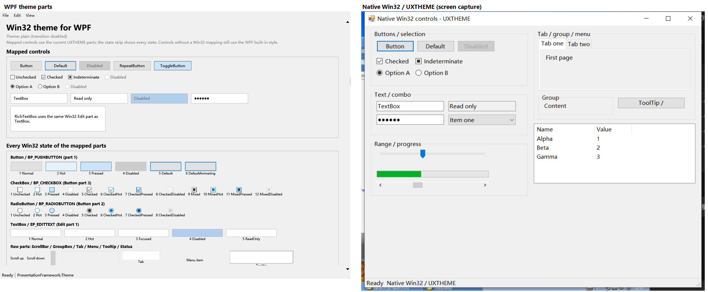

# PresentationFramework.Theme

> 本项目仅适用于 Windows XP；此项目由 AI (DeepSeek) 完成。

[English](README.md) | 简体中文

在 WPF 中直接使用 **Win32 视觉样式（UXTHEME）** 的控件主题库。

引入一个 `ResourceDictionary` 后，已映射的 WPF 控件会使用当前 Windows 主题的真实部件绘制，
而不是 WPF 自带皮肤的近似效果。库同时提供**无过渡**和**带过渡**两个版本。

## 与原生 Win32 对比

`NativeComparison.exe` 是一个纯 Win32/WinForms 对照窗口，使用 `Application.EnableVisualStyles()` +
comctl32 v6 manifest，直接创建原生 Button / CheckBox / ComboBox / TrackBar / ProgressBar /
TabControl / ScrollBar / StatusBar / ToolTip / ContextMenu：

```powershell
.\NativeComparison\bin\Release\NativeComparison.exe --out=native.png
```



### 哪些部分是 UxTheme，哪些不是

- **是**：背景/边框像素通过 `OpenThemeData(hwnd, class)` + `DrawThemeBackground` 绘制；
  尺寸与九宫格来自 `GetThemePartSize` / `GetThemeMargins`。
- **不是**：文字没有用 `DrawThemeText`，仍是 WPF `ContentPresenter`（字体、行高、内边距由
  WPF/模板决定）；ScrollBar 箭头叠加了 WPF `Path`；顶级菜单用系统色高亮；部分部件在缺失时
  使用 fallback margin/近似布局。
- `HackImage` 会把主题部件先渲染成 64×40 或自然尺寸的图片再九宫格拉伸；原生控件是在最终
  尺寸上直接 `DrawThemeBackground`，所以边角、圆角、细线可能有细微差别。
- 因此准确说法是：**用 UxTheme 的真实部件图作为 WPF 模板的背景素材**，不是“整个控件由
  UxTheme 原生绘制”。
## 快速使用

把主题字典合并到应用（或窗口）资源即可，隐式样式会自动生效：

```xml
<Application.Resources>
  <ResourceDictionary>
    <ResourceDictionary.MergedDictionaries>
      <ResourceDictionary Source="pack://application:,,,/PresentationFramework.Theme;component/theme.xaml" />
    </ResourceDictionary.MergedDictionaries>
  </ResourceDictionary>
</Application.Resources>
```

带过渡效果（状态切换时交叉淡入，150 ms）：

```xml
<ResourceDictionary Source="pack://application:,,,/PresentationFramework.Theme;component/theme.withtransition.xaml" />
```

引用程序集：`PresentationFramework.Theme.dll`、`ThemeExplorer.Core.dll`。

> 请在创建窗口/控件之前合并字典；运行中替换字典只影响之后创建的控件。

## 与已有样式组合

WPF 的资源字典不会合并 Style 的 Setter。对于隐式样式键 `{x:Type Button}`，同一个键最终只有一个字典生效：后合并的字典覆盖前面的字典。`DynamicResource` 也只是解析一个键，不会合并样式。

如果应用已有隐式样式，请保留主题字典，并让应用样式基于带键的主题基础样式：

```xml
<Style TargetType="Button" BasedOn="{StaticResource ThemeButtonStyle}">
  <Setter Property="Margin" Value="4" />
</Style>
```

所有已映射控件都有对应的键：

```text
ThemeButtonStyle、ThemeCheckBoxStyle、ThemeTextBoxStyle……
```

推荐顺序：

```xml
<ResourceDictionary.MergedDictionaries>
  <ResourceDictionary Source="app.styles.xaml" />
  <ResourceDictionary Source="pack://application:,,,/PresentationFramework.Theme;component/theme.xaml" />
</ResourceDictionary.MergedDictionaries>
```

主题放在最后，主题隐式样式才会生效；如果应用样式必须优先，则放在主题之后，并用 `BasedOn="{StaticResource ThemeXxxStyle}"` 组合。

Windows 系统主题（例如 Classic）位于应用字典之下。主题隐式样式会替换对应的系统样式，而不会自动继承它。若某个控件的系统样式能作为资源访问，可以在自己的样式中使用 `BasedOn`；否则需要把那部分 Classic Setter 显式复制到组合样式中。

运行中替换 `MergedDictionaries[i]` 不会重新应用到已经存在的控件；应在创建窗口前应用，或重新创建/重新赋值样式。

## 示例覆盖

`ThemeDemo` 是一个可滚动/可截图的控制面板画廊，覆盖：

- **已映射控件**：`Button`、`RepeatButton`、`ToggleButton`、`CheckBox`（三态）、`RadioButton`、
  `TextBox`、`PasswordBox`、`RichTextBox`、`ComboBox`、`Slider`、`ScrollBar`、`ProgressBar`、
  `GroupBox`、`TabControl`/`TabItem`、`StatusBar`/`StatusBarItem`、`ContextMenu`/`MenuItem`、
  `Menu`、`ToolTip`、`Separator`。
- **全部状态条**：`Button` part 1 的 6 个状态、`CheckBox` part 3 的 12 个状态、
  `RadioButton` part 2 的 8 个状态、`Edit` part 1 的 5 个状态，用 `HackImage` 直接逐状态渲染。
- **仍使用 WPF 内建样式**：`ListBox`、`ListView`、`TreeView`、`DataGrid`、`Calendar`、
  `DatePicker`、`Expander`、`ToolBar`、`Label`、`Hyperlink`、`Image`。

| 控件 | 主题映射 | 覆盖状态 |
| --- | --- | --- |
| Button / RepeatButton / ToggleButton | ✅ | Normal / Hot / Pressed / Disabled / Default（Toggle 的 Checked） |
| CheckBox | ✅ | Unchecked / Checked / Mixed × Normal / Hot / Pressed / Disabled |
| RadioButton | ✅ | Unchecked / Checked × Normal / Hot / Pressed / Disabled |
| TextBox / PasswordBox / RichTextBox | ✅ | Normal / Hot / Focused / Disabled / ReadOnly |
| ComboBox | ✅ | Normal / Hot / Focused / Disabled，下拉项 Normal / Highlighted |
| ScrollBar | ✅ | 箭头 Normal / Hot / Pressed / Disabled；Thumb Normal / Hot / Pressed / Disabled |
| Slider | ✅ | Track / Thumb 的 Normal / Hot / Pressed / Focused / Disabled |
| ProgressBar | ✅ | Bar / Fill（Normal） |
| GroupBox | ✅ | Normal / Disabled |
| TabControl / TabItem | ✅ | Normal / Hot / Selected / Disabled / Focused（顶部页签） |
| StatusBar / ContextMenu / Menu / ToolTip / Separator | ✅ | 基础 Win32 边框/项/分隔线 |

> 说明：要字面覆盖 **WPF 的所有控件和所有状态**，需要为 ComboBox、ScrollBar、DataGrid、
> Calendar、Ribbon 等逐一实现完整模板（微软自带的 Aero 主题约 6000 行 XAML）。当前版本先完成
> 了最常用的输入/按钮类控件及它们的全部主题状态；画廊把其余控件也放进同一窗口，便于后续逐个
> 替换。

## 懒加载与资源回收

- **仅合并 XAML 不会加载任何图片。** 样式和模板由 WPF 延迟实例化，`ThemeImage` 附加属性只
  记录 class/part/state；真正的绘制发生在元素 `Loaded` 时。
- **只加载进入可视化树的部件。** 每个 `HackImage` 在加载时向 `ThemeImageProvider` 取图；
  同主题、同状态、同尺寸的图片通过**弱引用缓存**共享。
- **卸载即释放。** 元素 `Unloaded` 时立即把 `HackImage.Source` 置空、取消进行中的过渡，
  宿主同时释放对 `ThemeImageData` 的强引用；缓存只保留 `WeakReference`，没有任何静态强引用。
- **本机资源即用即毁。** 每次生成图片使用一个 DIB section + memory DC，绘制完立即
  `SelectObject` 还原、`DeleteObject`、`DeleteDC`；主题句柄 `HTHEME` 用 `using` 关闭。
- **过渡资源同样释放。** `HackImageTransition` 在完成或被打断时 `Dispose` 掉 9 个
  `WriteableBitmap`，并取消 `CompositionTarget.Rendering` 订阅。

自检可以量化这些行为：

```text
ThemeDemo.exe --selftest --out=<目录>
ThemeDemo.exe --transition --selftest --out=<目录>
```

输出示例（Windows 11 / 125% DPI，画廊实例）：

```text
images-created-after-merge=0       # 只合并字典：0 张
images-created-before-show=0       # 窗口构造但未显示：0 张
images-created-after-show=55       # 显示后按需创建（画廊全部状态 + 新控件）
images-cached-while-open=55        # 由控件持有
images-cached-after-close=0        # 关闭 + GC 后缓存归零
```

带过渡版本还会验证：状态切换后 50 ms 图片仍是旧的，350 ms 后已切换到新图；无过渡版本则
立即切换。实际日志：`transition-check=early-changed:False;late-changed:True`（过渡）与
`early-changed:True;late-changed:True`（无过渡）。弹层模板也会被真实打开验证：
`contextmenu-open=True`、`tooltip-open=True`、`combobox-open=True`。

## 自定义模板

在任意 `HackImage` 上使用 `ThemeImage` 附加属性即可：

```xml
<Window xmlns:pt="clr-namespace:System.Windows.Controls;assembly=PresentationFramework.Theme"
        xmlns:th="clr-namespace:Microsoft.Windows.Themes;assembly=PresentationFramework.Theme">
  <pt:HackImage th:ThemeImage.Class="Button"
                th:ThemeImage.Part="1"
                th:ThemeImage.State="1"
                th:ThemeImage.TransitionDuration="0:0:0.15" />
</Window>
```

- `Class` / `Part` / `State` 使用 Windows SDK 的 `xxx_P_*` / `xxx_S_*` 常量值。
- `HackThickness` 由库根据主题的 `TMT_SIZINGMARGINS` 自动设置，无需手写。
- 固定尺寸的字形（复选框/单选框）使用 `Image` 目标也可以；附加属性同时支持 `HackImage` 和
  `Image`。
- 过渡只对 `HackImage` 生效（`Image` 没有中间缓冲）；`TransitionDuration` 为 0 时立即切换。

## 诊断接口

```csharp
int created = ThemeImageDiagnostics.CreatedImageCount; // 累计创建张数
int cached  = ThemeImageDiagnostics.CachedImageCount;  // 弱缓存中仍存活张数
ThemeImageDiagnostics.ClearCache();                    // 清空缓存键（被控件引用的图片仍存活）
```

## 便携测试包（TestDemo）

`TestDemo/` 是可直接复制到 Windows XP 的发布目录，包含：

```text
ThemeDemo.exe
PresentationFramework.Theme.dll
ThemeExplorer.Core.dll
NativeComparison.exe
Run-All.bat
Run-Plain.bat
Run-Transition.bat
Run-Native.bat
Run-Demo.bat
```

在 XP 上双击 `Run-All.bat`，会在 `TestDemo\logs` 下生成：

```text
logs\plain\selftest.log
logs\plain\theme-plain.png
logs\transition\selftest.log
logs\transition\theme-withtransition.png
logs\native-win32.png
```

`NativeComparison.exe` 是原生 Win32 对照窗口，用来判断当前 XP 主题的真实外观。
## 构建

```powershell
powershell -ExecutionPolicy Bypass -File .\build.ps1 -Configuration Release -SelfTest
```

`build.ps1 -SelfTest` 会依次运行无过渡/带过渡两套自检并检查日志。

## 兼容性与限制

- .NET Framework 4.0 及以上、C# 6、AnyCPU；Windows XP 及以上（WPF 4.0 + UXTHEME）。
- 使用 `VisualStyle.Open(className)` 的零窗口模式，不需要 `HwndHost`/隐藏窗口。
- XP 上没有 `TMT_SIZINGMARGINS` 的类使用边框宽度或保守默认值做九宫格切片。
- 主题在运行中改变时，已加载的控件不会自动换肤；新加载的控件会使用新主题（缓存键包含主题
  文件/配色/尺寸）。
- 当前版本的 **Win32 映射**覆盖上表；`ListBox`、`ListView`、`TreeView`、`DataGrid`、
  `Calendar`、`DatePicker` 等仍是 WPF 内建样式，已放进画廊便于后续补齐。
- Slider 的刻度线（`TickPlacement`）、ComboBox 的完整可编辑体验、ScrollBar 的平滑 Thumb 外观、
  TabControl 的左/下/右页签、MenuItem 的勾选/图标列仍是简化实现；复杂状态会继续补。
- 字形图片以 `SystemColors.Control` 为背景合成；如果控件放在白色/自定义背景上，复选框角上
  可能看到一小块控件色。
- 仅处理系统 DPI，没有逐显示器 DPI 切换（net40 限制）。
- 过渡是图片交叉淡入，不是 WPF 动画属性；不会产生布局抖动。

## 目录

```
PresentationFramework.Theme/   类库（HackImage、ThemeImage、DIB 渲染、主题字典）
ThemeDemo/                     画廊演示 + 懒加载/回收/过渡自检
WpfApplicationTest/            原 HackImage/过渡测试程序
NativeComparison/              纯 Win32/WinForms 对照窗口
build.ps1                      编译 + 两套自检
docs/                          两套主题截图
```

## 参考和借用

- **Theme Explorer**：用于查看 Win32 UxTheme class / part / state 与属性的参考项目。  
  本项目的 part ID、state 映射以及 Theme Explorer 预览方式均参考了该项目。  
  项目地址：https://github.com/mity/theme-explorer
