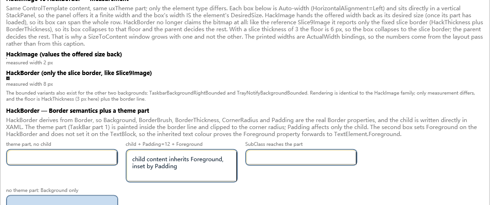
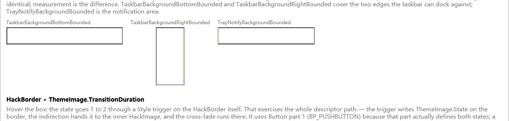
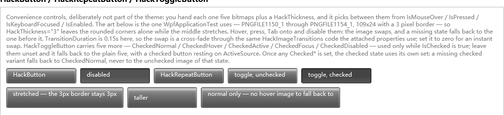

# Hack* components

The `Hack*` family turns a Win32 theme part, or a nine-patch bitmap you supply, into a
layout-friendly WPF element. The controls do not call `DrawThemeText` and do not host a native
window; they use the real UxTheme **part bitmaps** as template assets.

| Component | Base type | What it is for |
| --- | --- | --- |
| [`HackImage`](#hackimage) | `FrameworkElement` | A pure nine-patch image. No child, no chrome. |
| [`HackBorder`](#hackborder) | `Border` | A Border whose surface is a nine-patch theme part. |
| [`HackImageTransitions`](#hackimagetransitions) | static attached properties | Declarative cross-fade when a `HackImage` changes source. |
| [`HackImageTransition`](#hackimagetransition-manual-api) | `IDisposable` | The manual transition object behind the attached properties. |
| [`HackButton`](#hackbutton-and-hackrepeatbutton) | `Button` | One bitmap per visual state, with no `ControlTemplate`. |
| [`HackRepeatButton`](#hackbutton-and-hackrepeatbutton) | `RepeatButton` | Same image model, repeat behaviour inherited. |
| [`HackToggleButton`](#hacktogglebutton) | `ToggleButton` | Five base images plus five optional checked images. |

`ThemeHackImage` is a compatibility alias for `HackImage`, kept for code that already uses the
old name.

## Namespaces

```xml
xmlns:pt="clr-namespace:System.Windows.Controls;assembly=PresentationFramework.Theme"
xmlns:th="clr-namespace:Microsoft.Windows.Themes;assembly=PresentationFramework.Theme"
```

The `Hack*` controls are in `System.Windows.Controls`. `ThemeImage`, `ThemeImageDiagnostics` and
`ThemeResourceKeys` are in `Microsoft.Windows.Themes`.

## HackImage

### What it does

`HackImage` splits a bitmap into nine regions with `HackThickness`:

```text
+-----------+----------------------+-----------+
| top-left  |        top           | top-right |
+-----------+----------------------+-----------+
|   left    |       center         |   right   |
+-----------+----------------------+-----------+
| bot-left  |       bottom         | bot-right |
+-----------+----------------------+-----------+
```

The four corners keep their size, the four edges stretch in one direction, and the center
stretches in both directions. Slice boundaries are snapped to physical device pixels, which avoids
hairline seams between slices at fractional DPI.



*Above: the same theme part rendered through `HackImage` and through `HackBorder`. The difference is
measurement: `HackImage` returns the finite width offered by its parent, while `HackBorder` measures
like a Border.*

### Properties

| Property | Type | Default | Meaning |
| --- | --- | --- | --- |
| `Source` | `ImageSource` | `null` | The nine-patch bitmap. Must be a `BitmapSource` (`BitmapImage`, `BitmapFrame`, `CroppedBitmap`, ...). |
| `HackThickness` | `Thickness` | `0` | Slice sizes `Left, Top, Right, Bottom`, in **image pixels**, not DIP. |
| `IsSourceShrink` | `bool` | `false` | If the bitmap is smaller than the slice sum, stretch the whole bitmap instead of drawing nothing. |
| `ScalingMode` | `BitmapScalingMode` | `HighQuality` | Bitmap scaling filter. Use `NearestNeighbor` for pixel art. |
| `ThemeDescriptorSource` | `DependencyObject` | `null` | Advanced: read `ThemeImage` descriptors from another object. `HackBorder` uses this internally. |

`HackImage` has no child. Its `MeasureOverride` is deliberately simple:

- no bitmap: desired size is `0 x 0`;
- finite available width/height: returns the available width/height (it fills the slot);
- infinite available size: returns the bitmap's natural size.

That last rule is why a `HackImage` directly in a `StackPanel` can claim the whole available width:
the panel gives it a finite width, so the image values it back. Use an explicit `Width`/`Height`, a
grid cell, or `HackBorder` when you want content-driven measurement.

### Loading a theme part

The normal way is to use the `ThemeImage` attached properties. The library opens the current visual
style, gets the part bitmap and sizing margins, and assigns `Source`/`HackThickness` through
`ThemeImageHost`.

```xml
<pt:HackImage th:ThemeImage.Class="Button" th:ThemeImage.Part="1" th:ThemeImage.State="1" th:ThemeImage.TransitionDuration="0:0:0.15" />
```

- `Class`, `Part` and `State` use the numeric values of the Windows SDK `xxx_P_*` and `xxx_S_*`
  constants.
- If the theme exposes `TMT_SIZINGMARGINS`, `HackThickness` is filled in automatically.
- `ThemeImage.TransitionDuration` uses the same transition engine as the attached properties below.
  A value of zero switches immediately.

### Using an explicit bitmap

You can bypass UxTheme and supply your own image:

```xml
<pt:HackImage Source="{StaticResource MyNinePatch}" HackThickness="6,6,6,6" Width="160" Height="36" />
```

Set `HackThickness` yourself in this case. The values are in the bitmap's pixel coordinate system.
For a 96 DPI bitmap, one image pixel equals one DIP; for a high-DPI bitmap, the element converts
through the bitmap's `DpiX`/`DpiY`.

### Invalid slices and fallback

If `Left + Right` is greater than the bitmap pixel width, or `Top + Bottom` is greater than the
height:

- `IsSourceShrink="False"` (default): all nine slices are cleared and nothing is drawn;
- `IsSourceShrink="True"`: the whole bitmap is drawn stretched into the element bounds.

The whole-image fallback is intentionally a different visual (it scales corners and edges together).
It is useful for small parts where a nine-patch would collapse, but it is not a substitute for a
correct `HackThickness`.

## HackBorder

`HackBorder` is a real `Border` subclass. `Background`, `BorderBrush`, `BorderThickness`,
`CornerRadius`, `Padding` and the single XAML child all keep normal Border semantics.

### Composition order

```text
Background (Border)
    -> border line (BorderBrush)
        -> theme part (nine-patch)
            -> child content
```

The `Border` paints its `Background` and `BorderBrush` first. The theme part is drawn above that
surface, inside the border line, and clipped to `CornerRadius`; the child is drawn above the part.
`Padding` affects only the child; it does not inset the bitmap. The part starts inside
`BorderThickness`, so the border line stays visible around a rounded frame.

### Properties

| Property | Type | Default | Meaning |
| --- | --- | --- | --- |
| `Source` | `ImageSource` | `null` | Optional explicit nine-patch. Normally left unset; `ThemeImage` descriptors load it. |
| `HackThickness` | `Thickness` | `0` | Nine-patch slices in image pixels. |
| `IsSourceShrink` | `bool` | `false` | Whole-image fallback when slices do not fit. |
| `ScalingMode` | `BitmapScalingMode` | `HighQuality` | Bitmap scaling filter. |
| `Foreground` | `Brush` | inherited | Convenience property mirrored to `TextElement.Foreground` for the child. |

The descriptors go on the `HackBorder` itself:

```xml
<pt:HackBorder th:ThemeImage.Class="TaskBar" th:ThemeImage.Part="1" th:ThemeImage.TransitionDuration="0:0:0.15" CornerRadius="4" Padding="6">
  <TextBlock Text="Inside the part" />
</pt:HackBorder>
```

### Measurement

`HackBorder` does **not** use the bitmap's natural size as its desired size. It measures the inner
image with infinite available size (to capture the slice size for diagnostics), collapses that
measurement, and lets the Border measure its child. The resulting desired size is the fixed slice
border (`HackThickness + BorderThickness`) or the child, whichever is larger.

Consequences:

- an empty `HackBorder` with no `HackThickness` measures `0 x 0` and fills whatever space it is
  given;
- a `HackBorder` with content behaves like a Border and does not expand a `SizeToContent` window;
- if you need a minimum size, set `MinWidth`/`MinHeight` explicitly.



## HackImageTransitions

`HackImageTransitions` is the declarative API. It is a static class with attached properties, so it
can be driven by a `Style`, `DataTrigger`, `EventTrigger` or an `Interaction.Triggers` action.

| Attached property | Type | Default | Meaning |
| --- | --- | --- | --- |
| `To` | `ImageSource` | `null` | Target image. `null` means transparent. Changing it starts a transition. |
| `Duration` | `Duration` | `500 ms` | Cross-fade duration. `0` assigns immediately. |
| `Easing` | `IEasingFunction` | `null` | Easing function; `null` is linear. |
| `IsRunning` | `bool` (read-only) | `false` | True while a transition is active. Useful in triggers/tests. |

### Example: hover and press

```xml
<pt:HackImage x:Name="Art" Source="{StaticResource NormalImage}" Width="160" Height="36" pt:HackImageTransitions.Duration="0:0:0.15">
  <pt:HackImage.Style>
    <Style TargetType="{x:Type pt:HackImage}">
      <Setter Property="pt:HackImageTransitions.To" Value="{StaticResource NormalImage}" />
      <Style.Triggers>
        <Trigger Property="IsMouseOver" Value="True">
          <Setter Property="pt:HackImageTransitions.To" Value="{StaticResource HotImage}" />
        </Trigger>
        <DataTrigger Binding="{Binding IsPressed, RelativeSource={RelativeSource AncestorType={x:Type Button}}}" Value="True">
          <Setter Property="pt:HackImageTransitions.To" Value="{StaticResource PressedImage}" />
        </DataTrigger>
      </Style.Triggers>
    </Style>
  </pt:HackImage.Style>
</pt:HackImage>
```

`HackImage` has no `IsPressed` property; the pressed trigger reads the containing `Button` (the same
pattern used by a close button). For a standalone image with no Button ancestor, use
`IsMouseOver` only.

The default `To` is important: when the pointer leaves, the trigger is removed and `To` returns to
`NormalImage`, so the control fades back. If you set `To` to `null` on mouse leave, it fades to
transparent instead.

### Behaviour and lifetime

- Changing `To` while a transition is running takes the **current intermediate frame** as the new
  start, so rapid hover/press changes do not jump back.
- Setting `To` to the same image reference is a no-op.
- At completion, `Source` is updated with `SetCurrentValue`, which preserves `Source` bindings; the
  transition's pixel buffers are disposed.
- If either image cannot be sliced (slice sum exceeds the bitmap extent and `IsSourceShrink` is
  false), the target is assigned immediately with no animation.
- `To=null` is supported: the outgoing image fades to transparent.
- The attached transition is owned by the target. Do not start a second manual
  `HackImageTransition` on the same element at the same time.

## HackImageTransition (manual API)

Use the manual class only when you need direct control over start/stop, frame sampling or lifetime.
The attached properties are preferable for normal UI.

| Member | Meaning |
| --- | --- |
| `HackImageTransition(HackImage target, ImageSource from, ImageSource to, TimeSpan duration)` | Creates a transition. `from`/`to` may be `null` for transparent. |
| `Target` | The `HackImage` being animated. |
| `Completed` | Raised after the target `Source` has been switched to the destination. |
| `Easing` | Optional `IEasingFunction`. |
| `MaxFrameRate` | Frame cap, default `24`. |
| `Start()` | Starts updating the target's slices. |
| `Stop()` | Ends the animation, switches the target `Source` to the destination, and raises `Completed`; safe to call repeatedly. |
| `GetCurrentFrame()` | Returns the current composited frame, for interruption/hand-off. |
| `Dispose()` | Calls `Stop()` (which switches to the destination) and releases the nine `WriteableBitmap` buffers; safe to call repeatedly. |

```csharp
var transition = new HackImageTransition(image, fromImage, toImage, TimeSpan.FromMilliseconds(150));
transition.Completed += delegate { transition.Dispose(); };
transition.Start();
```

A transition writes temporary slices through `HackImage.SetSliceImages`. On completion it sets the
target `Source` to the destination and raises `Completed`; the attached-property path also clears its
private transition state. A manual transition must still be disposed by your code. `Stop()` is a
completion, not a cancel: it switches to the destination. To keep an intermediate image, call
`GetCurrentFrame()` first and set `Source` yourself afterwards.

## HackButton and HackRepeatButton

`HackButton` and `HackRepeatButton` are convenience wrappers for "one bitmap per state". They use no
`ControlTemplate` and are deliberately **not** part of the theme: you supply the images. This makes
them suitable for custom toolbars, notification buttons, splitter buttons and other small controls.

| Property | Type | Default | Meaning |
| --- | --- | --- | --- |
| `NormalSource` | `ImageSource` | `null` | Resting image. |
| `HoverSource` | `ImageSource` | `null` | Mouse-over image. |
| `ActiveSource` | `ImageSource` | `null` | Pressed image. |
| `FocusSource` | `ImageSource` | `null` | Keyboard-focus image. |
| `DisabledSource` | `ImageSource` | `null` | Disabled image. |
| `HackThickness` | `Thickness` | `0` | Nine-patch slices in image pixels. |
| `TransitionDuration` | `Duration` | `0` | State cross-fade duration. Zero switches immediately. |
| `TransitionEasing` | `IEasingFunction` | `null` | Easing for state changes. |

### State selection

Priority is **disabled > pressed > mouse over > keyboard focus > normal**. A missing image falls
back as follows:

| State | Source |
| --- | --- |
| disabled | `DisabledSource ?? NormalSource` |
| pressed | `ActiveSource ?? HoverSource ?? NormalSource` |
| mouse over | `HoverSource ?? NormalSource` |
| keyboard focused | `FocusSource ?? HoverSource ?? NormalSource` |
| normal | `NormalSource` |

The button blocks the implicit `{x:Type Button}` style by assigning an empty local style in its
constructor. If your application has an explicit `Style` for `HackButton`, assign it normally.

```xml
<pt:HackButton NormalSource="{StaticResource ToolbarNormal}" HoverSource="{StaticResource ToolbarHot}" ActiveSource="{StaticResource ToolbarPressed}" DisabledSource="{StaticResource ToolbarDisabled}" HackThickness="5" TransitionDuration="0:0:0.15" Padding="10,4" Content="OK" />
```

`HackRepeatButton` has the same image contract and inherits `RepeatButton.Delay` and
`RepeatButton.Interval`.



## HackToggleButton

`HackToggleButton` adds a checked image set to the same model. It has the five base sources above
plus five optional checked sources:

| Checked source | Used when checked and... |
| --- | --- |
| `CheckedNormalSource` | resting; also the fallback for every missing checked state |
| `CheckedHoverSource` | mouse over |
| `CheckedActiveSource` | pressed |
| `CheckedFocusSource` | keyboard focused |
| `CheckedDisabledSource` | disabled |

### Checked-state rules

`IsChecked == true` is the only checked state; `Indeterminate` is treated as unchecked.

If **any** `Checked*` source is set (`HasCheckedArt` is true), the checked state uses its own set:

- baseline: `CheckedNormalSource ?? ActiveSource ?? NormalSource`;
- disabled: `CheckedDisabledSource ?? baseline`;
- pressed: `CheckedActiveSource ?? baseline`;
- mouse over: `CheckedHoverSource ?? baseline`;
- keyboard focus: `CheckedFocusSource ?? baseline`;
- resting: `baseline`.

A missing checked variant falls back to the checked baseline, never to the unchecked art. This
prevents a checked button from showing the unchecked hover/focus appearance.

If **no** `Checked*` source is set, the control keeps the old "checked looks pressed" behaviour:
checked resting uses `ActiveSource ?? NormalSource`, and the normal five-image fallback chain
applies.

```xml
<pt:HackToggleButton NormalSource="{StaticResource ToggleNormal}" CheckedNormalSource="{StaticResource ToggleChecked}" CheckedHoverSource="{StaticResource ToggleCheckedHot}" HackThickness="4" Content="Pin" IsChecked="True" />
```

## Recipes

### A themed surface with content

Use `HackBorder` when the part is the background and you need a child:

```xml
<pt:HackBorder th:ThemeImage.Class="TaskBar" th:ThemeImage.Part="1" CornerRadius="3" Padding="8,4">
  <TextBlock Text="Toolbar" />
</pt:HackBorder>
```

### A custom button with one bitmap per state

Use `HackButton` when you already have five bitmaps:

```xml
<pt:HackButton NormalSource="{StaticResource CloseNormal}" HoverSource="{StaticResource CloseHot}" ActiveSource="{StaticResource ClosePressed}" HackThickness="3" Width="21" Height="20" />
```

### A close button that fades between states

Use a single `HackImage` and drive `HackImageTransitions.To` from triggers. Set an explicit
`Width`/`Height` (or put it in a fixed-size parent), because `HackImage` otherwise fills the
available button area.

```xml
<pt:HackImage Source="{StaticResource CloseNormal}" Width="21" Height="20" HackThickness="3" pt:HackImageTransitions.To="{StaticResource CloseNormal}" pt:HackImageTransitions.Duration="0:0:0.15">
  <pt:HackImage.Style>
    <Style TargetType="{x:Type pt:HackImage}">
      <Style.Triggers>
        <Trigger Property="IsMouseOver" Value="True">
          <Setter Property="pt:HackImageTransitions.To" Value="{StaticResource CloseHot}" />
        </Trigger>
        <DataTrigger Binding="{Binding IsPressed, RelativeSource={RelativeSource AncestorType={x:Type Button}}}" Value="True">
          <Setter Property="pt:HackImageTransitions.Duration" Value="0:0:0.1" />
          <Setter Property="pt:HackImageTransitions.To" Value="{StaticResource ClosePressed}" />
        </DataTrigger>
      </Style.Triggers>
    </Style>
  </pt:HackImage.Style>
</pt:HackImage>
```

Put this `HackImage` inside the `Button` whose pressed state should drive the image:

```xml
<Button Width="21" Height="20" Padding="0" BorderThickness="0" Background="Transparent">
  <!-- the HackImage from above goes here -->
</Button>
```

## Performance, lifetime and limitations

- `HackImage` creates nine `CroppedBitmap` objects per source. Assigning the same frozen
  `BitmapSource` to many controls shares the bitmap; the cropped slices are per control.
- Theme parts are loaded lazily by `ThemeImageHost`; merging the dictionary does not create images.
  `ThemeImageDiagnostics.CreatedImageCount` and `CachedImageCount` expose the counters.
- Transitions allocate nine `WriteableBitmap` buffers per running animation. They are disposed at
  completion; call `Dispose()` on a manual transition when you cancel it.
- Prefer frozen `BitmapImage` resources with `CacheOption=OnLoad` for state images. This avoids file
  locks and cross-thread access problems.
- `HackImage` is not a content control. Use `HackBorder` (or put it under a content presenter) when
  you need text/content.
- Nine-patch stretching is not suitable for parts whose edges contain gradients or detailed
  artwork that must not scale. Keep the stretchable edges simple, or use `HackBorder`/`HackImage`
  only for the chrome and draw the decoration separately.
- `HackButton`/`HackRepeatButton`/`HackToggleButton` do not read theme descriptors. Their images
  are your responsibility; `HackThickness` does not come from the theme automatically.
- The transition path requires sliceable bitmaps. If `IsSourceShrink` is false and the image is
  smaller than the slice sum, the animation falls back to an immediate switch.

## See also

- [ThemeImage and custom templates](../README.md#custom-templates)
- [Public resource keys](../README.md#public-resource-keys)
- [ThemeDemo](../ThemeDemo/MainWindow.xaml)
