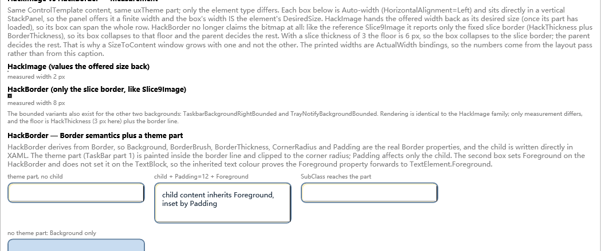
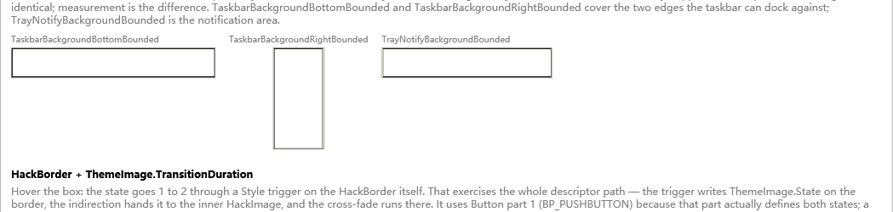
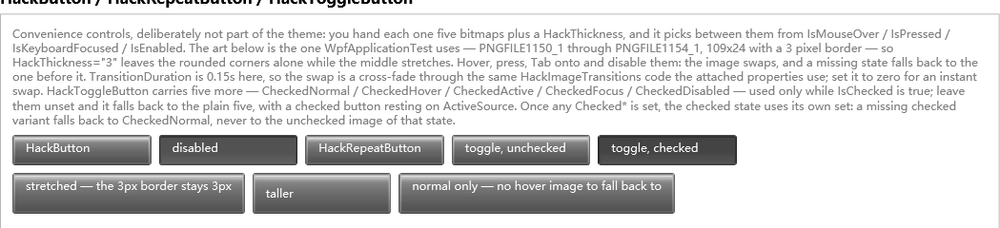

# Hack* 组件

`Hack*` 组件把 UxTheme 的真实部件位图，或你自己提供的九宫格位图，变成可参与 WPF 布局的元素。
它们不调用 `DrawThemeText`，也不承载原生窗口，只把主题部件当作 **WPF 模板背景素材**。

| 组件 | 基类 | 作用 |
| --- | --- | --- |
| [`HackImage`](#hackimage) | `FrameworkElement` | 纯九宫格图片，无子节点、无控件外观。 |
| [`HackBorder`](#hackborder) | `Border` | 表面为九宫格主题部件的 Border。 |
| [`HackImageTransitions`](#hackimagetransitions) | 静态附加属性 | 声明式图片交叉淡入。 |
| [`HackImageTransition`](#hackimagetransition手动-api) | `IDisposable` | 附加属性背后的手动过渡对象。 |
| [`HackButton`](#hackbutton-与-hackrepeatbutton) | `Button` | 每个状态一张图，不使用 ControlTemplate。 |
| [`HackRepeatButton`](#hackbutton-与-hackrepeatbutton) | `RepeatButton` | 同样的图片模型，继承重复按钮行为。 |
| [`HackToggleButton`](#hacktogglebutton) | `ToggleButton` | 五张基础图 + 五张可选的勾选态图。 |

`ThemeHackImage` 是 `HackImage` 的兼容别名，供已经使用旧名称的代码使用。

## 命名空间

```xml
xmlns:pt="clr-namespace:System.Windows.Controls;assembly=PresentationFramework.Theme"
xmlns:th="clr-namespace:Microsoft.Windows.Themes;assembly=PresentationFramework.Theme"
```

`Hack*` 控件位于 `System.Windows.Controls`；`ThemeImage`、`ThemeImageDiagnostics`、
`ThemeResourceKeys` 位于 `Microsoft.Windows.Themes`。

## HackImage

### 它做什么

`HackImage` 用 `HackThickness` 把位图切成九块：

```text
+-----------+----------------------+-----------+
|  左上角   |        上边           |  右上角   |
+-----------+----------------------+-----------+
|   左边    |        中心           |   右边    |
+-----------+----------------------+-----------+
|  左下角   |        下边           |  右下角   |
+-----------+----------------------+-----------+
```

四个角保持尺寸；四条边单向拉伸；中心双向拉伸。切片边界会对齐到物理像素，避免在非整数 DPI
下切片之间出现细缝。



*上图：同一个主题部件分别用 `HackImage` 和 `HackBorder` 渲染。差异在测量：`HackImage` 会把
父级给的有限宽度原样作为自己的期望宽度；`HackBorder` 则按 Border 的方式测量。*

### 属性

| 属性 | 类型 | 默认值 | 说明 |
| --- | --- | --- | --- |
| `Source` | `ImageSource` | `null` | 九宫格位图，必须是 `BitmapSource`（`BitmapImage`、`BitmapFrame`、`CroppedBitmap` 等）。 |
| `HackThickness` | `Thickness` | `0` | 左、上、右、下切片，单位是**图像像素**，不是 DIP。 |
| `IsSourceShrink` | `bool` | `false` | 位图小于切片总尺寸时，是否退化为整图拉伸；`false` 时不绘制。 |
| `ScalingMode` | `BitmapScalingMode` | `HighQuality` | 位图缩放质量；像素画可用 `NearestNeighbor`。 |
| `ThemeDescriptorSource` | `DependencyObject` | `null` | 高级用法：从另一个对象读取 `ThemeImage` 描述符；`HackBorder` 内部使用。 |

`HackImage` 没有子节点。它的测量规则很简单：

- 没有位图：期望尺寸为 `0 x 0`；
- 可用宽高有限：返回可用宽高（填满父级给的槽位）；
- 可用宽高无限：返回位图的自然尺寸。

因此直接把 `HackImage` 放进 `StackPanel` 时，如果父级给了有限宽度，它会占满这一行。需要
内容驱动尺寸时，请使用显式 `Width`/`Height`、Grid 单元格，或改用 `HackBorder`。

### 用主题部件加载

常规方式是在 `HackImage` 上写 `ThemeImage` 附加属性。库会打开当前视觉样式，读取部件位图和
`TMT_SIZINGMARGINS`，再由 `ThemeImageHost` 设置 `Source`/`HackThickness`。

```xml
<pt:HackImage th:ThemeImage.Class="Button" th:ThemeImage.Part="1" th:ThemeImage.State="1" th:ThemeImage.TransitionDuration="0:0:0.15" />
```

- `Class`、`Part`、`State` 使用 Windows SDK 的 `xxx_P_*` / `xxx_S_*` 常量数值。
- 主题提供 `TMT_SIZINGMARGINS` 时，`HackThickness` 会自动填入。
- `ThemeImage.TransitionDuration` 与下面的附加属性共用同一套动画；为 0 时立即切换。

### 使用显式位图

也可以完全绕开 UxTheme，自己提供图片：

```xml
<pt:HackImage Source="{StaticResource MyNinePatch}" HackThickness="6,6,6,6" Width="160" Height="36" />
```

此时必须自己设置 `HackThickness`，数值以位图的像素坐标为准。96 DPI 位图的一个图像像素等于
一个 DIP；高 DPI 位图则按位图的 `DpiX`/`DpiY` 换算。

### 切片不合法时的退化

如果 `Left + Right` 大于位图像素宽，或 `Top + Bottom` 大于位图像素高：

- `IsSourceShrink="False"`（默认）：清空九块切片，不绘制；
- `IsSourceShrink="True"`：把整张位图拉伸填满元素。

整图拉伸会把角和边一起缩放，只适合小部件；只要能修正 `HackThickness`，就不要依赖它。

## HackBorder

`HackBorder` 是真正的 `Border` 子类。`Background`、`BorderBrush`、`BorderThickness`、
`CornerRadius`、`Padding` 和 XAML 中的单个子节点全部保持 Border 语义。

### 绘制顺序

```text
Background（Border 自己）
    -> 边框线（BorderBrush）
        -> 主题部件（九宫格）
            -> 子节点内容
```

`Border` 先绘制 `Background` 和 `BorderBrush`。主题部件画在边框线内侧，位于该表面之上，并按
`CornerRadius` 裁剪；子节点再画在主题部件之上。`Padding` 只影响子节点，不会把位图往里缩。
主题部件从 `BorderThickness` 内侧开始，因此圆角边框线仍然可见。

### 属性

| 属性 | 类型 | 默认值 | 说明 |
| --- | --- | --- | --- |
| `Source` | `ImageSource` | `null` | 可选的显式九宫格；通常不设，由 `ThemeImage` 描述符加载。 |
| `HackThickness` | `Thickness` | `0` | 九宫格切片，单位图像像素。 |
| `IsSourceShrink` | `bool` | `false` | 切片不合法时是否整图拉伸。 |
| `ScalingMode` | `BitmapScalingMode` | `HighQuality` | 位图缩放质量。 |
| `Foreground` | `Brush` | 继承 | 便利属性，转发到子节点的 `TextElement.Foreground`。 |

描述符直接写在 `HackBorder` 上：

```xml
<pt:HackBorder th:ThemeImage.Class="TaskBar" th:ThemeImage.Part="1" th:ThemeImage.TransitionDuration="0:0:0.15" CornerRadius="4" Padding="6">
  <TextBlock Text="部件里的内容" />
</pt:HackBorder>
```

### 测量

`HackBorder` **不会**把位图的自然尺寸当作自己的期望尺寸。它先用无限可用尺寸测量内部图片
（用于诊断，记录切片大小），然后折叠这次测量，再按 Border 的方式测量子节点。最终期望尺寸取
“固定切片边（`HackThickness + BorderThickness`）”与“子节点尺寸”中的较大者。

由此得到：

- 没有子节点、也没设 `HackThickness` 的 `HackBorder` 测量为 `0 x 0`，给多少空间就填多少；
- 有内容的 `HackBorder` 行为与 Border 一致，不会把 `SizeToContent` 窗口撑大；
- 需要最小尺寸时显式设置 `MinWidth`/`MinHeight`。



## HackImageTransitions

`HackImageTransitions` 是声明式 API：一组静态附加属性，可以被 `Style`、`DataTrigger`、
`EventTrigger` 或 `Interaction.Triggers` 驱动。

| 附加属性 | 类型 | 默认值 | 说明 |
| --- | --- | --- | --- |
| `To` | `ImageSource` | `null` | 目标图片；`null` 表示透明。改变它即启动过渡。 |
| `Duration` | `Duration` | `500 ms` | 交叉淡入时长；0 表示立即赋值。 |
| `Easing` | `IEasingFunction` | `null` | 缓动函数；`null` 为线性。 |
| `IsRunning` | `bool`（只读） | `false` | 过渡进行中为 true，可用于触发器或测试。 |

### 示例：悬停与按下

```xml
<pt:HackImage x:Name="Art" Source="{StaticResource NormalImage}" Width="160" Height="36" pt:HackImageTransitions.Duration="0:0:0.15">
  <pt:HackImage.Style>
    <Style TargetType="{x:Type pt:HackImage}">
      <Setter Property="pt:HackImageTransitions.To" Value="{StaticResource NormalImage}" />
      <Style.Triggers>
        <Trigger Property="IsMouseOver" Value="True">
          <Setter Property="pt:HackImageTransitions.To" Value="{StaticResource HotImage}" />
        </Trigger>
        <DataTrigger Binding="{Binding IsPressed, RelativeSource={RelativeSource AncestorType={x:Type Button}}}" Value="True">
          <Setter Property="pt:HackImageTransitions.To" Value="{StaticResource PressedImage}" />
        </DataTrigger>
      </Style.Triggers>
    </Style>
  </pt:HackImage.Style>
</pt:HackImage>
```

`HackImage` 本身没有 `IsPressed` 属性；上面的按下触发器读取外层 `Button` 的状态（关闭按钮就是
这种用法）。如果图片不在 Button 里，只保留 `IsMouseOver` 即可。

默认 `To` 很重要：鼠标离开后触发器移除，`To` 回到 `NormalImage`，控件会淡回常态。如果鼠标
离开时把 `To` 设为 `null`，它会淡到透明。

### 行为与生命周期

- 过渡进行中再次改变 `To`，会以当前中间帧作为新的起点，连续悬停/按下不会跳回。
- `To` 与当前图片是同一个引用时，不做任何事。
- 完成时用 `SetCurrentValue` 更新 `Source`，保留绑定；同时释放过渡的像素缓冲。
- 任一张图无法切片（切片总尺寸超出位图且 `IsSourceShrink` 为 false）时，直接切换，不播放动画。
- 支持 `To=null`：旧图淡出到透明。
- 过渡对象由目标元素持有；不要同时手动 `HackImageTransition.Start()` 同一元素。

## HackImageTransition（手动 API）

只有需要直接控制启动/停止、采样或生命周期时才使用手动类。普通 UI 优先用附加属性。

| 成员 | 说明 |
| --- | --- |
| `HackImageTransition(HackImage target, ImageSource from, ImageSource to, TimeSpan duration)` | 创建过渡；`from`/`to` 可为 `null`（透明），但不能同时为 `null`。 |
| `Target` | 被动画的 `HackImage`。 |
| `Completed` | 过渡完成、目标 `Source` 已切换后触发。 |
| `Easing` | 可选缓动函数。 |
| `MaxFrameRate` | 帧率上限，默认 24。 |
| `Start()` | 开始更新目标切片。 |
| `Stop()` | 结束动画：把目标 `Source` 切到 `_to` 并触发 `Completed`；重复调用安全。 |
| `GetCurrentFrame()` | 返回当前合成帧，用于打断/接续。 |
| `Dispose()` | 调用 `Stop()` 并释放九个 `WriteableBitmap` 缓冲；可重复调用。 |

```csharp
var transition = new HackImageTransition(image, fromImage, toImage, TimeSpan.FromMilliseconds(150));
transition.Completed += delegate { transition.Dispose(); };
transition.Start();
```

手动过渡完成时同样会把目标 `Source` 切到目标图；`Dispose()` 也会先完成切换再释放缓冲。如果
你希望取消后保留原图，必须在 `Dispose()` 之后再把 `Source` 设回需要的图片。

## HackButton 与 HackRepeatButton

`HackButton`、`HackRepeatButton` 是“每个状态一张图”的便捷封装。它们不使用
`ControlTemplate`，也**不属于主题**：图片由使用者提供，适合工具栏、通知按钮、分隔条按钮等
自定义小控件。

| 属性 | 类型 | 默认值 | 说明 |
| --- | --- | --- | --- |
| `NormalSource` | `ImageSource` | `null` | 常态图。 |
| `HoverSource` | `ImageSource` | `null` | 悬停图。 |
| `ActiveSource` | `ImageSource` | `null` | 按下图。 |
| `FocusSource` | `ImageSource` | `null` | 键盘焦点图。 |
| `DisabledSource` | `ImageSource` | `null` | 禁用图。 |
| `HackThickness` | `Thickness` | `0` | 九宫格切片，单位图像像素。 |
| `TransitionDuration` | `Duration` | `0` | 状态交叉淡入时长；0 表示立即切换。 |
| `TransitionEasing` | `IEasingFunction` | `null` | 状态切换缓动。 |

### 状态选择

优先级为 **禁用 > 按下 > 鼠标悬停 > 键盘焦点 > 常态**。缺图时按以下顺序回退：

| 状态 | 使用的图 |
| --- | --- |
| 禁用 | `DisabledSource ?? NormalSource` |
| 按下 | `ActiveSource ?? HoverSource ?? NormalSource` |
| 鼠标悬停 | `HoverSource ?? NormalSource` |
| 键盘焦点 | `FocusSource ?? HoverSource ?? NormalSource` |
| 常态 | `NormalSource` |

构造函数会给控件设置一个空的本地 `Style`，用来阻断隐式的 `{x:Type Button}` 样式。若应用里
有显式的 `HackButton` 样式，正常赋值即可。

```xml
<pt:HackButton NormalSource="{StaticResource ToolbarNormal}" HoverSource="{StaticResource ToolbarHot}" ActiveSource="{StaticResource ToolbarPressed}" DisabledSource="{StaticResource ToolbarDisabled}" HackThickness="5" TransitionDuration="0:0:0.15" Padding="10,4" Content="确定" />
```

`HackRepeatButton` 的图片来源与状态规则完全一致，并继承 `RepeatButton.Delay` 和
`RepeatButton.Interval`。



## HackToggleButton

`HackToggleButton` 在同样的模型上增加一套勾选态图片：五张基础图，加五张可选的 `Checked*` 图。

| 勾选态来源 | 何时使用 |
| --- | --- |
| `CheckedNormalSource` | 勾选且静止；也是所有缺失勾选态的最终回退 |
| `CheckedHoverSource` | 勾选且鼠标悬停 |
| `CheckedActiveSource` | 勾选且按下 |
| `CheckedFocusSource` | 勾选且有键盘焦点 |
| `CheckedDisabledSource` | 勾选且禁用 |

### 勾选态规则

只有 `IsChecked == true` 算勾选；`Indeterminate` 按未勾选处理。

只要设置了**任意一张** `Checked*`（`HasCheckedArt` 为 true），勾选态就使用独立的一套：

- 基线：`CheckedNormalSource ?? ActiveSource ?? NormalSource`；
- 禁用：`CheckedDisabledSource ?? 基线`；
- 按下：`CheckedActiveSource ?? 基线`；
- 鼠标悬停：`CheckedHoverSource ?? 基线`；
- 键盘焦点：`CheckedFocusSource ?? 基线`；
- 静止：基线。

缺失的勾选态会退回勾选基线，**不会**使用未勾选状态的图。这样勾选按钮不会突然显示未勾选
的悬停/焦点外观。

如果一张 `Checked*` 都没设，控件保持旧的“勾选看起来像按下”行为：勾选静止使用
`ActiveSource ?? NormalSource`，其余状态沿用普通五张图的回退链。

```xml
<pt:HackToggleButton NormalSource="{StaticResource ToggleNormal}" CheckedNormalSource="{StaticResource ToggleChecked}" CheckedHoverSource="{StaticResource ToggleCheckedHot}" HackThickness="4" Content="固定" IsChecked="True" />
```

## 常用配方

### 主题部件 + 内容

部件作为背景、需要放子节点时，用 `HackBorder`：

```xml
<pt:HackBorder th:ThemeImage.Class="TaskBar" th:ThemeImage.Part="1" CornerRadius="3" Padding="8,4">
  <TextBlock Text="工具栏" />
</pt:HackBorder>
```

### 每个状态一张图的自定义按钮

已经有五张图时，用 `HackButton`：

```xml
<pt:HackButton NormalSource="{StaticResource CloseNormal}" HoverSource="{StaticResource CloseHot}" ActiveSource="{StaticResource ClosePressed}" HackThickness="3" Width="21" Height="20" />
```

### 带淡入的关闭按钮

用单个 `HackImage`，由触发器驱动 `HackImageTransitions.To`。必须显式设置 `Width`/`Height`
（或放进固定尺寸父级），否则 `HackImage` 会占满按钮区域。

```xml
<pt:HackImage Source="{StaticResource CloseNormal}" Width="21" Height="20" HackThickness="3" pt:HackImageTransitions.To="{StaticResource CloseNormal}" pt:HackImageTransitions.Duration="0:0:0.15">
  <pt:HackImage.Style>
    <Style TargetType="{x:Type pt:HackImage}">
      <Style.Triggers>
        <Trigger Property="IsMouseOver" Value="True">
          <Setter Property="pt:HackImageTransitions.To" Value="{StaticResource CloseHot}" />
        </Trigger>
        <DataTrigger Binding="{Binding IsPressed, RelativeSource={RelativeSource AncestorType={x:Type Button}}}" Value="True">
          <Setter Property="pt:HackImageTransitions.Duration" Value="0:0:0.1" />
          <Setter Property="pt:HackImageTransitions.To" Value="{StaticResource ClosePressed}" />
        </DataTrigger>
      </Style.Triggers>
    </Style>
  </pt:HackImage.Style>
</pt:HackImage>
```

把这段 `HackImage` 放在负责按压状态的 `Button` 里：

```xml
<Button Width="21" Height="20" Padding="0" BorderThickness="0" Background="Transparent">
  <!-- 上面那段 HackImage 放在这里 -->
</Button>
```

## 性能、生命周期与限制

- 每个 `Source` 会创建九个 `CroppedBitmap`。多个控件引用同一张冻结的 `BitmapSource` 时，
  位图共享，但切片是每个控件各自持有的。
- 主题部件由 `ThemeImageHost` 懒加载；只合并字典不会创建图片。可用
  `ThemeImageDiagnostics.CreatedImageCount`、`CachedImageCount` 观察计数。
- 每次过渡会分配九个 `WriteableBitmap` 缓冲，完成时释放；手动过渡取消时请调用 `Dispose()`。
- 状态图建议使用冻结的 `BitmapImage` 资源并设置 `CacheOption=OnLoad`，避免文件锁和跨线程问题。
- `HackImage` 不是内容控件；需要文字/内容时用 `HackBorder`，或把它放到内容呈现器下面。
- 九宫格拉伸不适合边缘带渐变或细节、且不允许缩放的部件；这类部件只把边框交给 `HackImage`/
  `HackBorder`，装饰内容单独绘制。
- `HackButton`/`HackRepeatButton`/`HackToggleButton` 不读取主题描述符，图片和
  `HackThickness` 都由使用者负责，不会自动从主题获取。
- 过渡要求位图可切片；`IsSourceShrink` 为 false 且位图小于切片总尺寸时，会退化为立即切换。

## 另见

- [ThemeImage 与自定义模板](../README.zh-CN.md#自定义模板)
- [公开资源键](../README.zh-CN.md#公开资源键)
- [ThemeDemo](../ThemeDemo/MainWindow.xaml)
